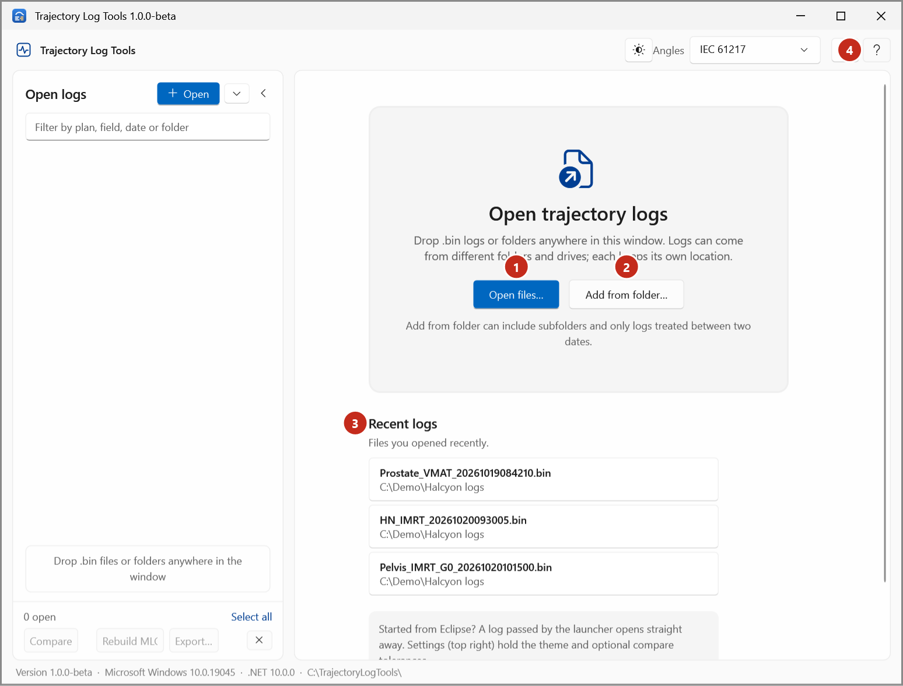

# First run

Check that Trajectory Log Tools works on a new workstation.

1. Start Trajectory Log Tools from **Tools > Scripts** in Eclipse (or double-click `TrajectoryLogTools.exe`).

    { .shot }

    The start page shows **Open files…** (1), **Add from folder…** (2) and the **Recent logs** (3)
    you opened before. **Help** (4) opens this guide.

2. Check the line at the bottom of the window. It shows the app's version, the Windows version, the
   .NET runtime and the folder the app runs from, for example:

    `Version 1.0.0-beta  ·  Microsoft Windows 10.0.19045  ·  .NET 10.0.0  ·  C:\TrajectoryLogTools\`

3. Select **Open files…**, pick a trajectory log and check it opens. See
   [Your first look at a log](../tutorials/first-look.md).
4. Select **Help**. This guide opens in your web browser. If it says the guide isn't installed, tell
   whoever looks after the deployment.

For the converter, see [Set the converter's folders](../how-to/converter-folders.md): it asks for its
default folders the first time.

## Defaults to know

- **Light theme.** Change it in [Settings](../how-to/change-theme.md).
- **Angles in IEC 61217.** Change it with **Angles** at the top of the window; see
  [Change the angle scale](../how-to/change-angle-scale.md).
- **Dates** are shown in the New Zealand format, dd/MM/yyyy with 24-hour times, whatever the PC's
  regional settings.
- **No extra files.** Run logs and QA report files are only written when you ask for them.
