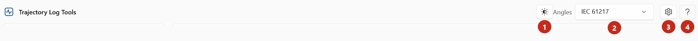

# Change the angle scale

Trajectory Log Tools shows gantry and collimator angles in **IEC 61217** by default. You can show them
in **Varian Standard** instead.

1. At the top of the window, open **Angles** (2) and choose **IEC 61217** or **Varian Standard**.

    { .shot }

    You can also change it in **Settings**, under **Angles**.

The pages update straight away: the axis charts, the field and beam-hold tables, the Compare charts and
tables, the Rebuild page and the details windows. Table headings say which scale they use, for
example *Fields · angles IEC 61217*.

What changes and what doesn't:

- Only gantry and collimator are converted. Couch and jaw values are shown as recorded.
- **Files aren't affected.** Exports keep the log's values, Eclipse MLC files are always IEC 61217, and
  the Compare report text is in the log's own scale (its header says which). The figure saved with a
  Compare report follows the setting.

Why there are two scales: [IEC 61217 and Varian Standard](../explanation/angles.md).
