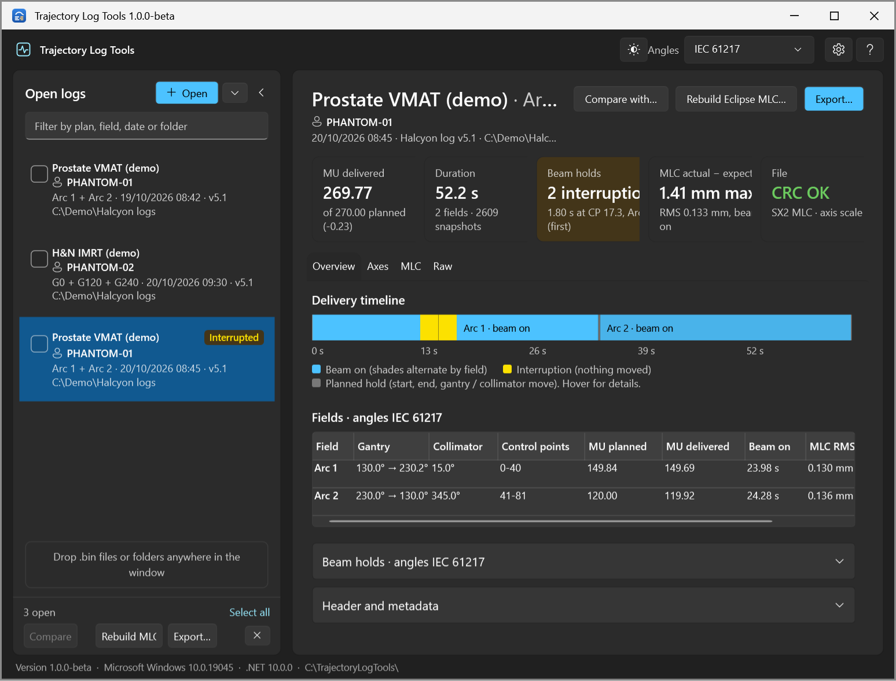

# Change the theme

Trajectory Log Tools starts in the light theme. You can switch to dark, or follow Windows.

- To switch between light and dark, select **◐** (1) at the top of the window.

    { .shot }

- Or select **Settings** (3), choose **Light**, **Dark** or **System** (follow Windows) under **Theme**,
  and select **Save**. The theme changes when you press **Save**.

The choice is saved for you (per Windows user). The charts follow the theme.

{ .shot }

Trajectory Log Converter always uses the light theme.
