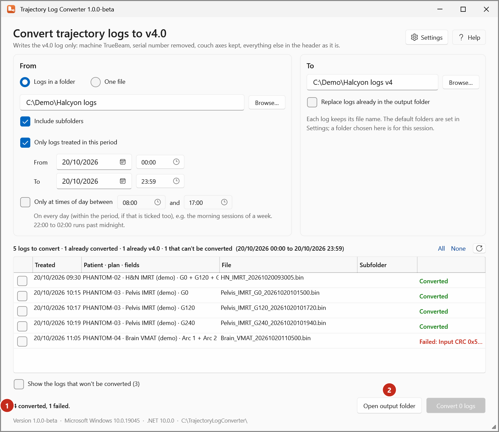

# Convert the day's logs

Convert the v5.1 logs treated today, from the default input folder, to v4.0 in the default output
folder with Trajectory Log Converter.

Before the first time, [set the converter's folders](converter-folders.md).

1. Start **Trajectory Log Converter** from **Tools > Scripts** in Eclipse.
2. Under **From**, keep **Logs in a folder** and the default folder.
3. Tick **Only logs treated in this period** (2) and set **From** to today 00:00 and **To** to today 23:59.

    { .shot }

4. Check the list (4). It shows every log that will be converted: when it was treated, the patient,
   plan and fields, the file and its subfolder. Untick any log you don't want converted.
5. Optional: tick **Show the logs that won't be converted** (5) to see the logs left out and why.

    { .shot }

6. Select **Convert _n_ logs** (6).

When it finishes, each log reads **Converted** (or why it was skipped or failed), and the total is
shown at the bottom. A log whose CRC checksum doesn't verify (it may be damaged) isn't converted: it
reads **Failed: Input CRC …**. Check the log with Trajectory Log Tools (its **Raw** tab).

{ .shot }

Select **Open output folder** (2) to see the v4.0 files. Each keeps its log's file name.

Logs already in the output folder aren't converted again, unless you tick
**Replace logs already in the output folder** under **To**.

What the converter writes, and why a log is left out: [Trajectory Log Converter](../reference/converter.md).

!!! warning "To be confirmed"
    When the day's logs should be converted (for example at the end of each session), and the real
    input and output folders.
