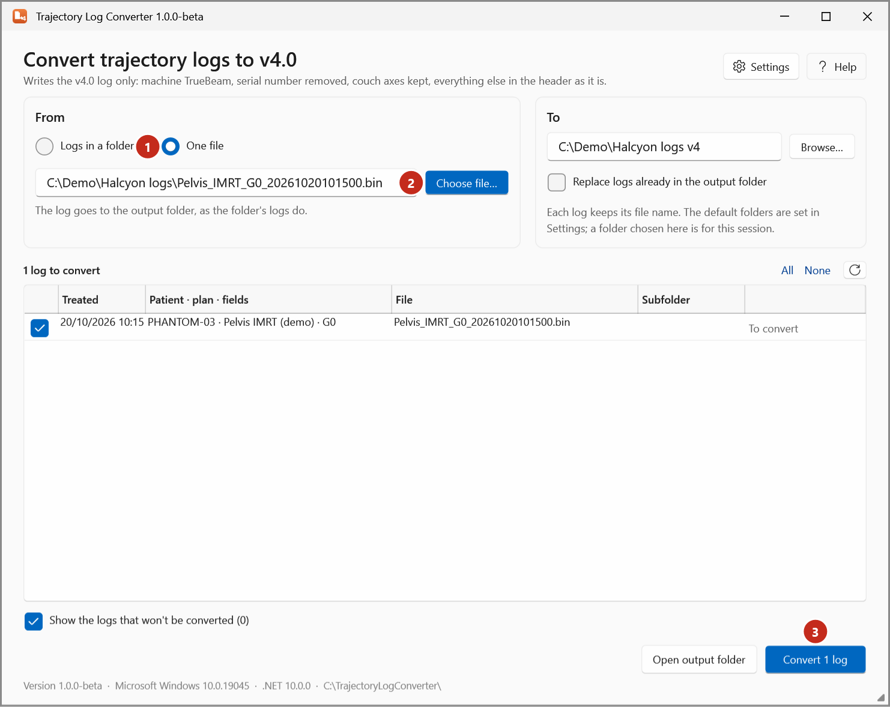

# Convert a single file

Convert one v5.1 log to v4.0 with Trajectory Log Converter. It goes to the output folder, like the
folder's logs.

1. Start **Trajectory Log Converter**.
2. Under **From**, select **One file** (1).
3. Select **Choose file…** (2) and pick the log, or type its path.

    { .shot }

4. Check the list: one row, *To convert*, or the reason it can't be converted.
5. Select **Convert 1 log** (3).

To convert a log with other options (for example keeping the serial number, or changing the patient
ID), use **Export** in Trajectory Log Tools instead: see [Export logs](export.md).
