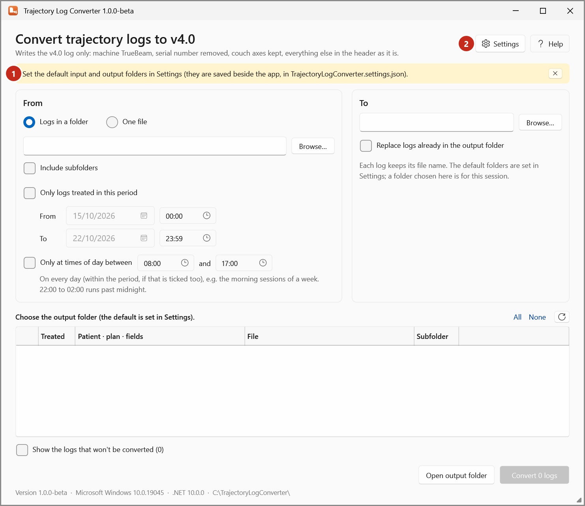
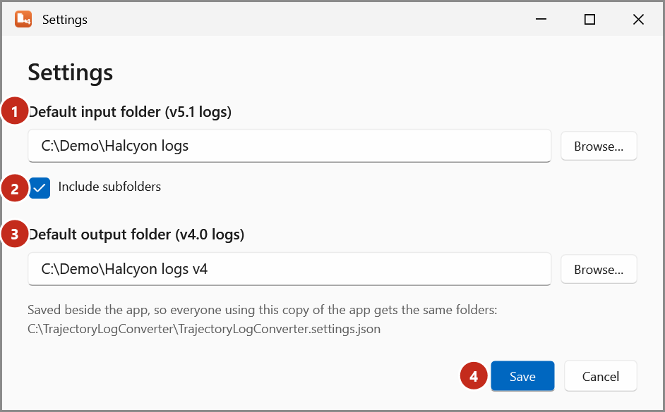

# Set the converter's folders

Trajectory Log Converter converts from a default input folder to a default output folder. Set them once
for everyone who uses that copy of the app.

!!! warning "To be confirmed"
    The department's input and output folders go here.

The first time, the converter asks for them:

{ .shot }

1. Select **Settings** (2).

    { .shot }

2. Under **Default input folder (v5.1 logs)** (1), type the folder or select **Browse…**.
3. Tick **Include subfolders** (2) if the logs are in folders inside it.
4. Under **Default output folder (v4.0 logs)** (3), type the folder or select **Browse…**. It must not be
   the input folder: the v4.0 files would replace the v5.1 logs.
5. Select **Save** (4).

The folders are saved in `TrajectoryLogConverter.settings.json` **in the app's folder**, so everyone
using that copy gets the same folders. To change them, you need write access to the app's folder;
otherwise the app says it couldn't save.

A folder chosen in the main window, with **Browse…**, is for that session only. **Back to the default
folder** returns to the saved one.
