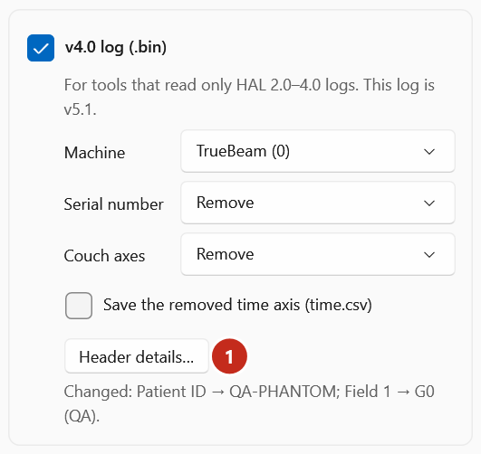
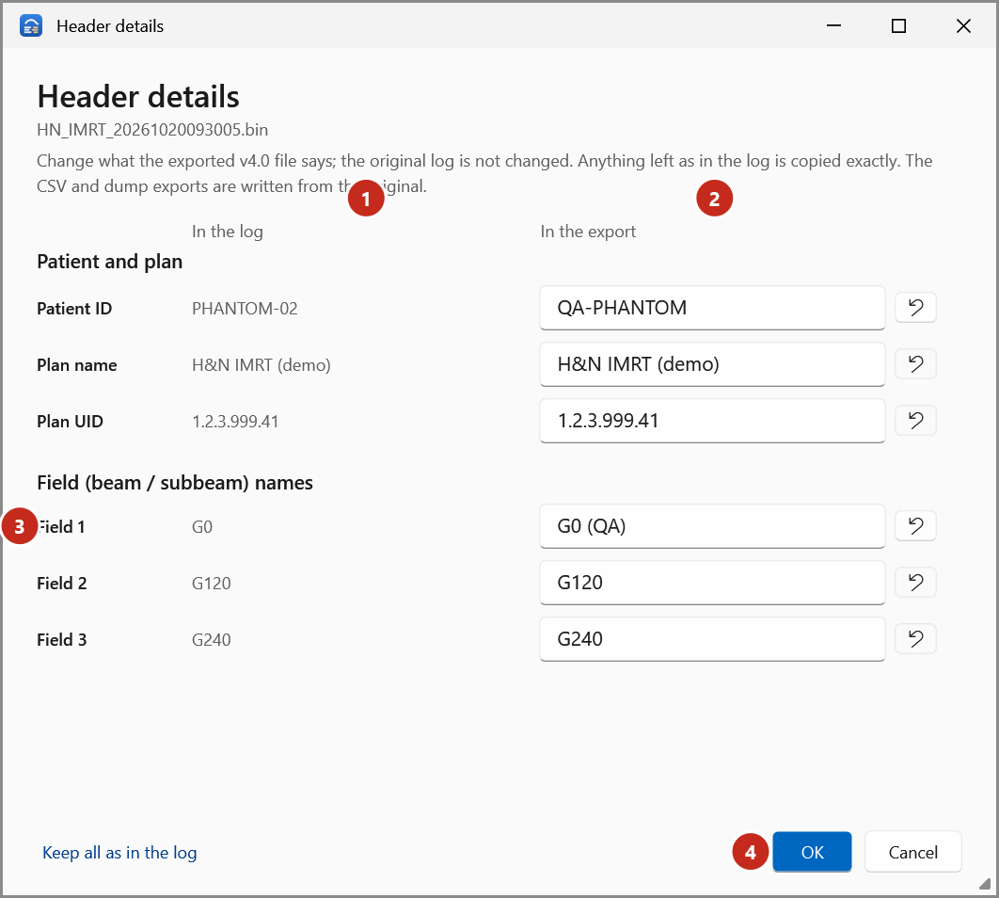

# Change header details

When you export **one v5.1 log** to v4.0, you can change the patient ID, plan name, plan UID and field
names written to the v4.0 file, for example to anonymise a QA delivery. The original log isn't changed,
and the CSV and dump exports are written from the original.

1. Show the log, select **Export…** and keep **v4.0 log (.bin)** ticked.
2. Select **Header details…** (1).

    { .shot }

3. In the **Header details** window, each value shows **In the log** (1) and **In the export** (2).
   Type the new values in the right-hand column.

    { .shot }

    - **↺** beside a value puts it back as in the log; **Keep all as in the log** puts back every value.
    - Renaming **Field 1** (3) also changes the header's *BeamName* line, which holds the first field's name.
    - **Other header metadata** lists the lines that are copied as they are.
4. Select **OK** (4). The Export window lists what you changed, for example
   *Changed: Patient ID → QA-PHANTOM; Field 1 → G0 (QA).*
5. Select **Export**.

Values must be one line each and fit in the header (745 bytes for all the metadata together); the app
tells you if one doesn't.

**Header details…** is only offered when one v5.1 log is exported.
