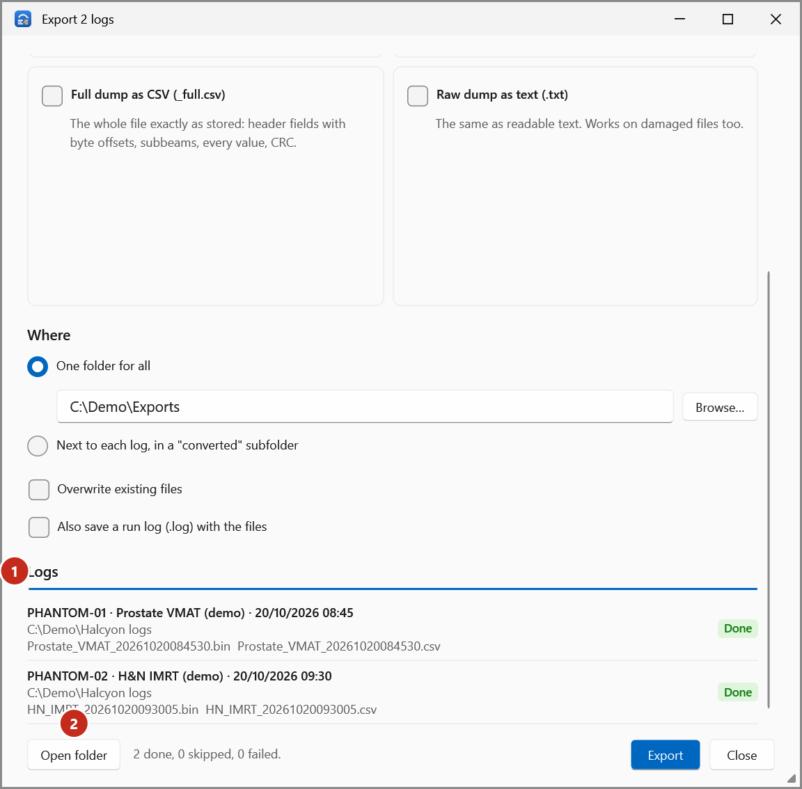

# Export logs

Write logs, wherever they are, as a v4.0 log, a CSV, a full dump as CSV, or a raw dump as text.
The original logs are never changed.

1. In **Open logs**, tick the logs to export, or show one log. Then select **Export…** (or press
   ++ctrl+e++). The **Export** window opens.

    { .shot }

2. Under **What to write**, tick one or more:
    - **v4.0 log (.bin)** (1): for tools that read only v4.0 logs. Logs that are already v4.0 are
      skipped. Choose the header options: **Machine**, **Serial number** and **Couch axes**.
    - **CSV (.csv)** (2): one row per 20 ms snapshot, expected and actual for every axis. Opens in
      Excel. Optionally **Leave out the MLC columns** or **Actual values only**.
    - **Full dump as CSV (_full.csv)** (3): the whole file exactly as stored.
    - **Raw dump as text (.txt)** (4): the same as readable text; works on damaged files too.
3. Under **Where** (5), choose **One folder for all** and type or **Browse…** for the folder, or
   **Next to each log, in a "converted" subfolder**.
4. Optional: tick **Overwrite existing files**, or **Also save a run log (.log) with the files**.
5. Select **Export** (6).

Progress is shown for each log, with **Done**, **Skipped** or **Failed** and the files written:

{ .shot }

Select **Open folder** (2) to see the files. Every option is described in
[Export options](../reference/export-options.md).

!!! note
    The app refuses to write a v4.0 file into the folder of one of the logs, where it would replace
    the original. Choose another folder, or *next to each log*.

To change the patient ID, plan name or field names in a v4.0 export, see
[Change header details](export-header-details.md).
