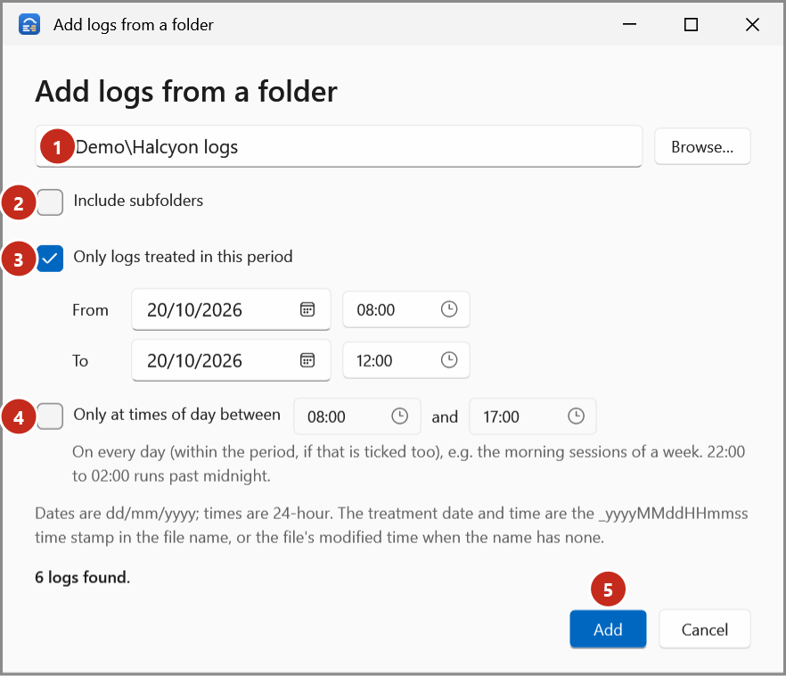
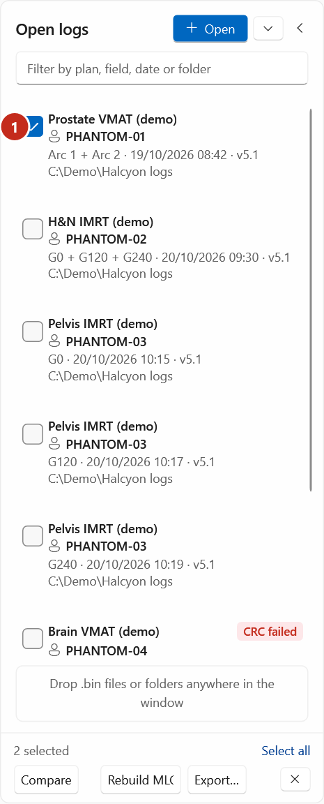
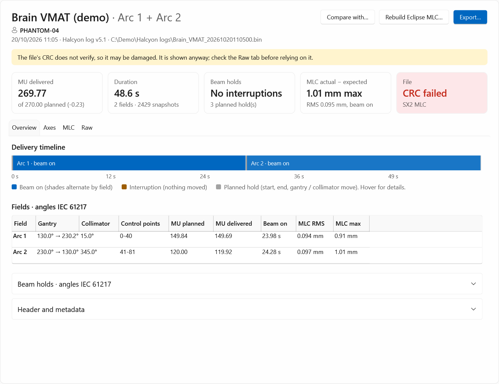

# Open logs

Open trajectory logs (`.bin`, or CSV exports of a log) from any folder or drive. Each log keeps its
own location, so logs from different folders sit side by side in **Open logs**. Opening a log never
changes it.

## Open files

1. Select **Open** (or press ++ctrl+o++). On the start page, select **Open files…**.
2. Select one or more logs (hold ++ctrl++ or ++shift++ for more than one) and select **Open**.

## Add the logs of a folder, with a date and time filter

1. Select **▾** next to **Open**, then **Add from folder…**. On the start page, select **Add from folder…**.

    { .shot }

2. Type the folder, or select **Browse…** (1).
3. Tick **Include subfolders** (2) to search the folders inside it too.
4. To take only the logs treated in a period, tick **Only logs treated in this period** (3) and set
   **From** and **To**, each a date and a time. The end minute is included: 20/10/2026 08:00 to
   20/10/2026 12:00 takes logs up to 12:00:59.
5. To take only the logs treated at some times of day, tick **Only at times of day between** (4)
   and set the two times, for example 08:00 and 12:00 for the morning sessions. It applies to every
   day (within the period, if that is ticked too); 22:00 to 02:00 runs past midnight.
6. Check the count under the filters, for example *3 logs found*, then select **Add** (5).

!!! note "Treatment date and time"
    The apps take a log's treatment date and time from the `_yyyyMMddHHmmss` time stamp in its file
    name, as the machine names them, or from the file's modified time when the name has none.

## Drag and drop

Drag `.bin` files, or folders, from File Explorer anywhere onto the window. A folder opens
**Add from folder** for it.

## Open a recent log

- Select **▾**, then **Recent logs**, then the log; or
- on the start page, select the log under **Recent logs**.

The app remembers the last 12 files you opened. To clear the list, see [Settings](../reference/settings.md).

## Open a log from Eclipse or the command line

A log passed by the Eclipse launcher, or dragged onto `TrajectoryLogTools.exe`, opens straight away.

## Find, select and close logs

- Type in the filter box above the list to show only logs whose plan, patient ID, field, date,
  version or folder match.
- Tick logs to select them for **Compare** (two), **Rebuild MLC…** or **Export…** (any number).
  **Select all** ticks every log shown.
- **✕** (or ++ctrl+w++) closes the ticked logs, or the shown log. Nothing is deleted.
- **‹** folds the list to a narrow strip when you want the room.

## Badges

After a log has been read (when it is first shown, compared, rebuilt or exported), a badge marks:

| Badge | Meaning |
|---|---|
| **Interrupted** | The delivery has at least one interruption (an unplanned beam hold). |
| **CRC failed** | The file's checksum doesn't verify; it may be damaged. It opens anyway, with a warning. |
| **Can't read** | The file couldn't be read as a trajectory log. |

{ .shot }

{ .shot }
