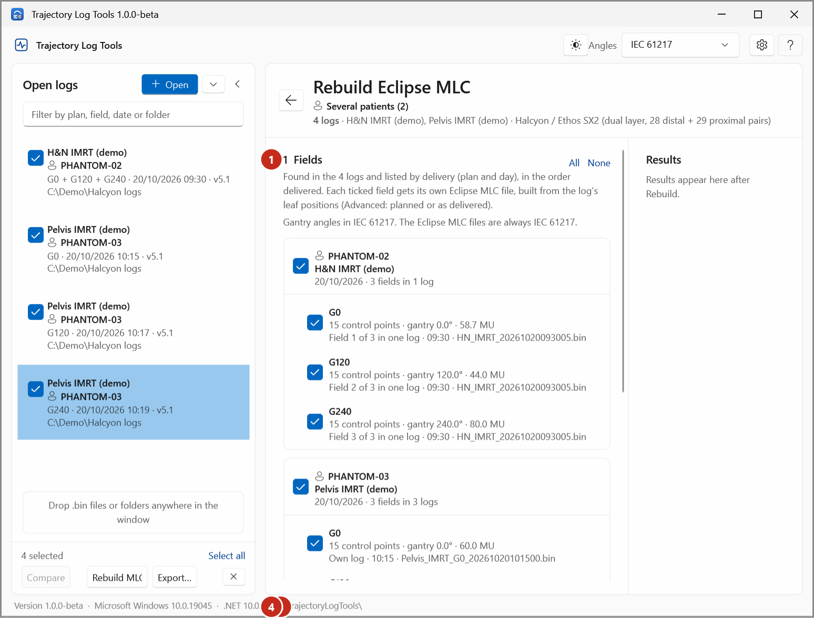
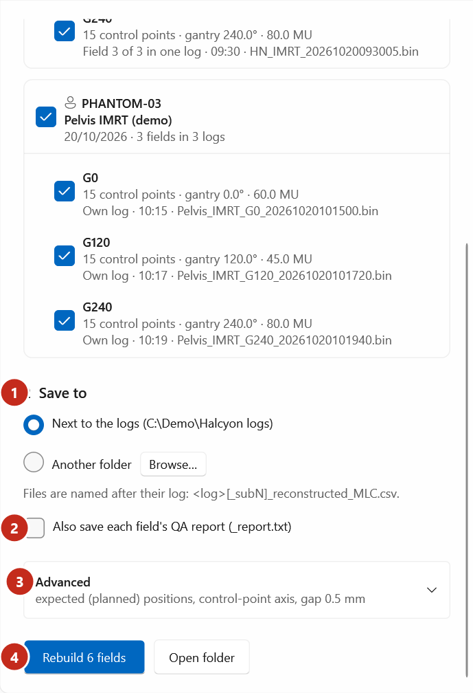

# Rebuild Eclipse MLC files

Make, for each field of a delivery, an Eclipse MLC file (the *MLCPlan serialization* `.csv` that
Eclipse exports and imports) from the leaf positions in its trajectory log. Each field gets a status
that says whether the file is ready to import.

!!! warning "To be confirmed"
    What the rebuilt files are used for in the department (for example a dose recalculation of the
    delivered fraction), and the Eclipse import procedure. See
    [Intended use and limitations](../about/intended-use.md).

## Choose the logs

Do one of these:

- In **Open logs**, tick the logs of the delivery (one log per field, or one log with several fields)
  and select **Rebuild MLC…**.
- On a log's page, select **Rebuild Eclipse MLC…**. If that log is ticked, all the ticked logs are used.

The **Rebuild Eclipse MLC** page opens.

{ .shot }

## Rebuild

1. Check the fields under **1  Fields** (1). They are found automatically and listed by delivery: one
   box per plan and day, its fields in the order delivered. Each field shows its control points,
   gantry and MU, and where it came from: *Field 1 of 3 in one log* (2) when the machine wrote one log
   for the delivery, or *Own log* (3) when it wrote one per field, then the time and the file.
    - Untick a field you don't want, or a whole delivery with the tick of its box. **All** and **None**
      tick or untick everything.
    - A field found in two logs of one delivery (usually one resumed after an interruption) is marked
      *Delivered 2 times…*; each part gets its own file.
    - Logs that can't be rebuilt are listed under **Not included**, with the reason.
2. Scroll down. Under **2  Save to** (1), choose **Next to the log** (each file beside its log), or
   **Another folder** and select **Browse…**.
    - In one folder, two logs with the same file name would overwrite each other's files, so the app
      refuses; save next to each log instead.
    { .shot }

3. Optional: tick **Also save each field's QA report (_report.txt)** (2). The report is in **Details…**
   either way.
4. Leave **Advanced** (3) as it is, unless you know you need another method. See
   [How the MLC rebuild works](../explanation/mlc-rebuild.md).
5. Select **Rebuild _n_ fields** (4).

## Check the results

Each field gets a card under **Results**:

{ .shot }

1. Read the status (1):
    - **Ready to import**: no check found a problem.
    - **Check first**: the file was written, but read the reasons listed on the card before using it.
    - **Failed**: nothing was written; the reason is on the card.
2. Read the three columns: **Leaf positions written**, **Eclipse leaf-gap rules** and **Gantry**.
3. Select **Details…** (2) for the field's QA report, the difference map and a leaf-by-leaf view, in a
   window of its own. **‹** and **›** step through the fields.

    { .shot }

4. Select **Open folder** to see the files. Each is named after its log:
   `<log>[_subN]_reconstructed_MLC.csv` (`_subN` when the log holds several fields).

What each status and check means: [Rebuild statuses and checks](../reference/rebuild-statuses.md).

The Eclipse MLC files are always in IEC 61217, whatever the **Angles** setting.
