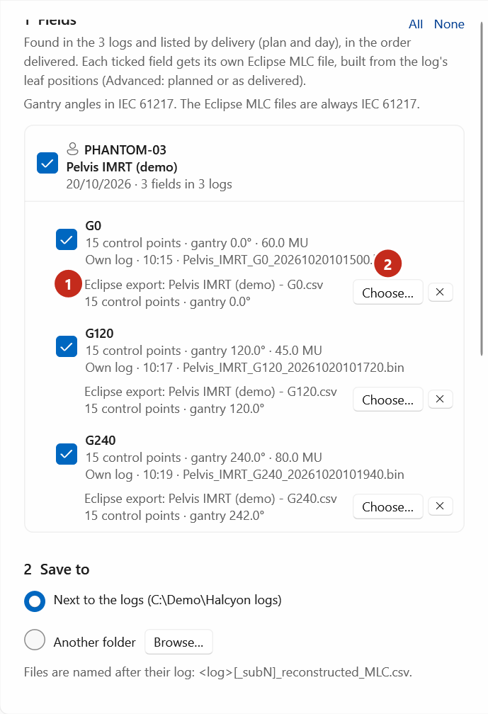
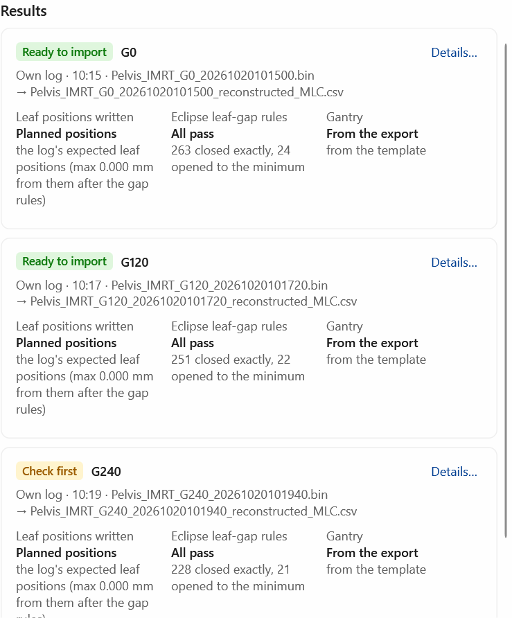
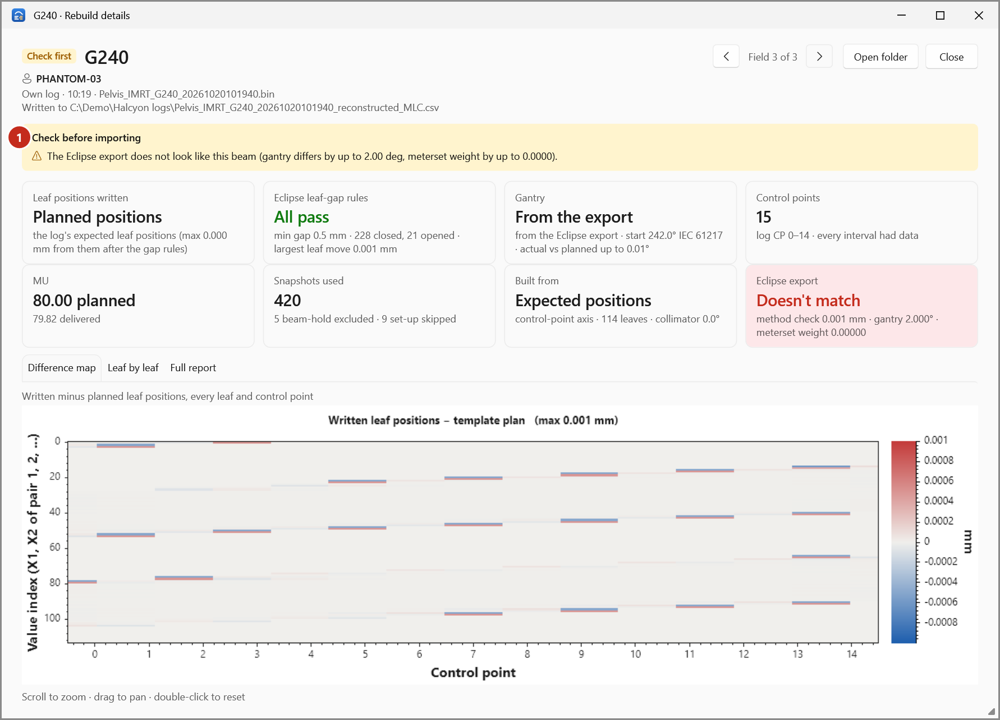

# Rebuild with Eclipse exports

With an Eclipse export of each beam (the MLC file Eclipse exports for the planned field), the rebuilt
file keeps Eclipse's own header, meterset weights, jaws and angles, and only the leaf positions are
replaced. The export is also checked against the log.

1. In Eclipse, export the MLC of each field of the plan (outside this app).
2. Open the logs and start the rebuild (see [Rebuild Eclipse MLC files](rebuild-mlc.md)).
3. Open **Advanced** and tick **Use Eclipse exports of these beams** (2).
4. Select **Add exports…** and select the exports of all the fields. You can also drop the `.csv`
   files onto the page.

    { .shot }

    The exports are matched to the fields by number of control points and gantry angle, so their
    order doesn't matter. Each field shows its export (3), with its control points and gantry.
    To change one, select **Choose…** beside it; **✕** removes it.
5. Every ticked field needs an export. An export that fits no field is listed in a message at the top.
6. Select **Rebuild _n_ fields**.

## If an export doesn't fit

A field whose export doesn't look like its beam is marked **Check first**:

{ .shot }

{ .shot }

The details give the gantry and meterset-weight differences and the **Eclipse export** card reads
*Doesn't match*. Check that you exported the right beam of the right plan.
