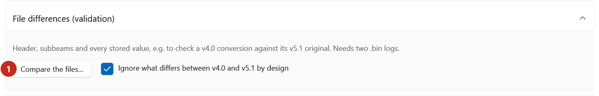
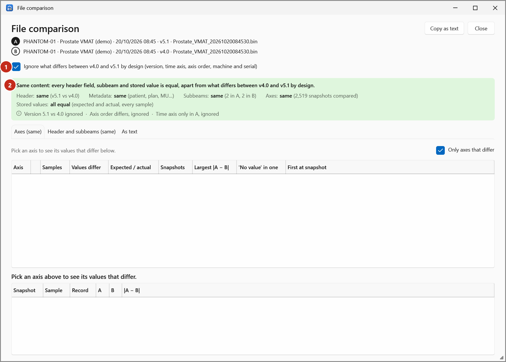

# Validate a v4.0 conversion

Check that a v4.0 log made from a v5.1 log (by Export or by Trajectory Log Converter) holds the same
values as its original. **File comparison** compares every header field, subbeam and stored value.

1. Open the v5.1 original and its v4.0 conversion (see [Open logs](open-logs.md)).
2. Tick both and select **Compare**.

    The delivery comparison should say *Same plan, delivered twice* with differences of zero.

3. Scroll down and open **File differences (validation)**.

    { .shot }

4. Leave **Ignore what differs between v4.0 and v5.1 by design** ticked, and select
   **Compare the files…** (1). The **File comparison** window opens.

    { .shot }

5. Read the verdict (2). For a good conversion it is:

    *Same content: every header field, subbeam and stored value is equal, apart from what differs
    between v4.0 and v5.1 by design.*

    and every count reads *same* or *all equal*.

## What "by design" ignores

A conversion changes these on purpose (see [Log versions 4.0 and 5.1](../explanation/log-versions.md)):
the version string, the time axis (v4.0 has none), the order of the axes, and the machine specifier
and serial number. With the box ticked, they're not counted as differences.

Untick the box to see them:

{ .shot }

- (1) **Axes**: each axis that differs, how many values, expected and actual, in how many snapshots,
  the largest difference, values that are "no value" in one log only, and the first snapshot.
- (2) The values that differ on the axis you select above.

The **Header and subbeams** tab lists each header field that differs, A and B side by side;
**As text** gives the comparison as text (**Copy as text** copies it).

{ .shot }

!!! tip
    If the verdict reports differences you don't expect, keep both files and
    [report a problem](report-a-problem.md).

See also [File comparison](../reference/file-comparison.md) for every column.
