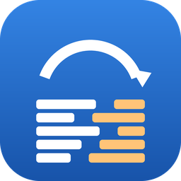

# Trajectory Log Tools

**Trajectory Log Tools** and **Trajectory Log Converter** are two Windows apps for the trajectory logs
that Halcyon and Ethos treatment machines write for every delivery (`.bin` files, versions 4.0 and 5.1).

{ .shot }

-   :material-rocket-launch: **New here?**

    Start with [what the apps are for](getting-started/index.md), then take
    [your first look at a log](tutorials/first-look.md).

-   :material-format-list-checks: **Want to do something?**

    The [how-to guides](how-to/index.md) cover one task each: open logs, compare deliveries,
    rebuild Eclipse MLC files, export, convert the day's logs.

-   :material-book-open-variant: **Looking something up?**

    The [reference](reference/index.md) lists every setting, export option, status and control.

-   :material-lightbulb-on: **Want to understand?**

    The [explanation](explanation/index.md) pages cover angle scales, log versions, the MLC rebuild
    and what each comparison compares.

## The two apps

| App | Use it to |
|---|---|
| { width="20" } **Trajectory Log Tools** (`TrajectoryLogTools.exe`) | View a log, compare two deliveries, check a v4.0 conversion, rebuild Eclipse MLC files from a delivery, and export logs (v4.0, CSV, dumps). |
| { width="20" } **Trajectory Log Converter** (`TrajectoryLogConverter.exe`) | Convert v5.1 logs to v4.0, from a default input folder to a default output folder, in a few clicks. |

Both apps only read and write files. They don't open an Eclipse (ESAPI) session and don't change the
logs you open. See [Privacy and Eclipse](explanation/privacy.md).

!!! warning "To be confirmed"
    The department's intended use statement for the apps goes here. See
    [Intended use and limitations](about/intended-use.md).

!!! tip "Help in the apps"
    Select **Help** (or press ++f1++) in either app to open this guide at the page for the window you're in.
