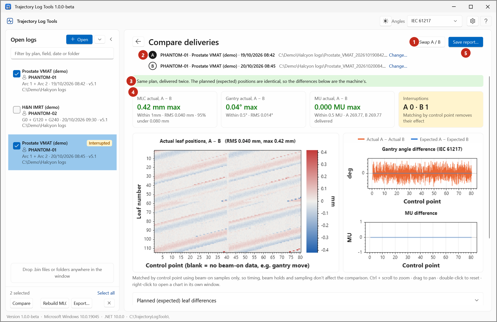
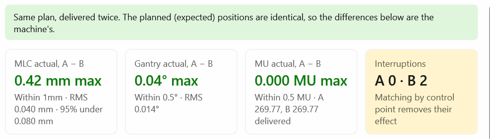
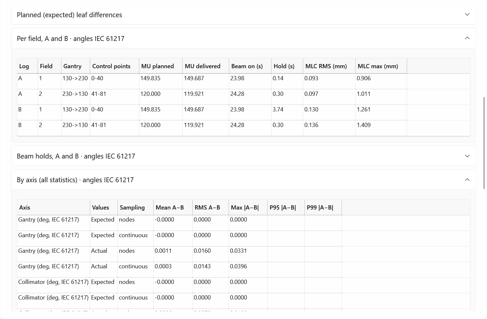

# Compare cards and statistics

The **Compare deliveries** page of Trajectory Log Tools. See
[Compare two deliveries](../how-to/compare-deliveries.md) for the steps.

{ .shot }

## A and B

Each line shows the patient ID, the plan and treatment date, and the file. **Change…** picks another
log; you can also drop a log onto the line. **Swap A / B** swaps them. Every difference is A − B.

## The verdict

| Verdict | When |
|---|---|
| *Same plan, delivered twice. The planned (expected) positions are identical, so the differences below are the machine's.* (green) | The planned leaf positions differ by less than 0.01 mm and the planned gantry by less than 0.05°. |
| *The plans differ: planned leaf positions differ by up to _x_ mm and planned gantry by up to _y_°. The delivered differences below include the plan differences.* (orange) | Otherwise. |

A red warning says when A and B are different patients.

## The cards

{ .shot }

| Card | Value | Detail | Tolerance |
|---|---|---|---|
| **MLC actual, A − B** | Max \|A − B\| over every leaf and matched sample (mm) | RMS, and the 95th percentile | **MLC** |
| **Gantry actual, A − B** | Max \|A − B\| (°) | RMS | **Gantry** |
| **MU actual, A − B** | Max \|A − B\| (MU) | MU delivered by A and B | **MU** |
| **Interruptions** | Unplanned beam holds in A and in B | Orange when there are any | — |

With a tolerance set in [Settings](settings.md), a card is green and reads *Within _t_* when its value is
at most the tolerance, red with *Over _t_* otherwise.

## The charts

- **Leaf difference map**: actual A − actual B for every leaf (rows) and control point (columns). The
  colour scale is fitted to the data.
- **Gantry** and **MU**: A − B against control point, actual (orange) and expected (blue).

Charts zoom and pan separately; right-click to open one in its own window.

## The details

{ .shot }

| Section | Contents |
|---|---|
| **Planned (expected) leaf differences** | The same map for the expected positions: all zero for the same plan. |
| **Per field, A and B** | Per log and field: gantry, control points, MU planned and delivered (3 decimals), beam on (s), hold (s), MLC RMS and max (mm). |
| **Beam holds, A and B** | Every hold of each log: type, field, start, duration, control point, gantry, collimator. |
| **By axis (all statistics)** | Per axis, for expected and actual values: **Mean A−B**, **RMS A−B**, **Max \|A−B\|**, **P95 \|A−B\|** and **P99 \|A−B\|**, with the sampling. |
| **File differences (validation)** | Opens the [File comparison](file-comparison.md). |
| **Full report** | The report as text, with angles as recorded in the log. |

## How the deliveries are matched

Only beam-on samples are used. Each is placed at its control point, and A and B are compared at the
same control points, so timing, beam holds and the sampling don't affect the comparison. A first
snapshot recorded more than 0.5 s before the rest (seen in some v5.1 logs) is left out. See
[Compare and File comparison](../explanation/compare-vs-file-comparison.md).
