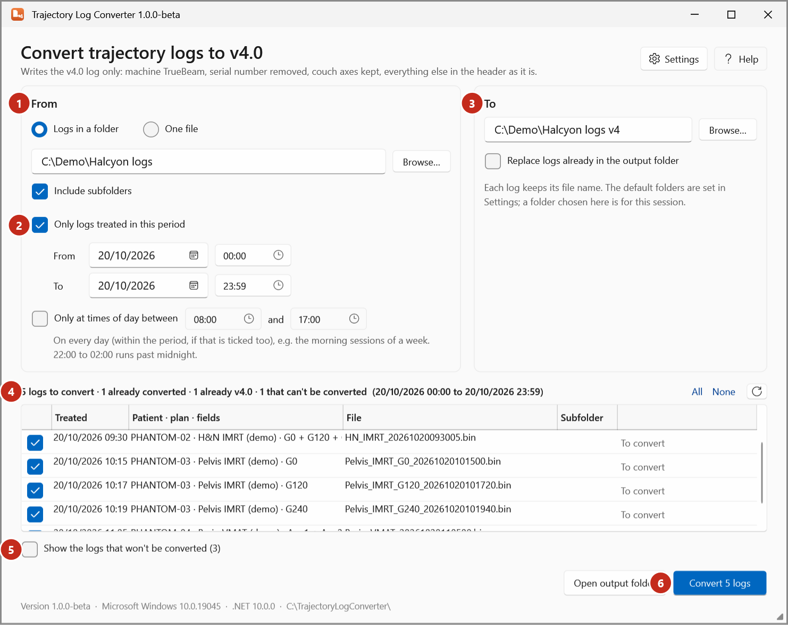
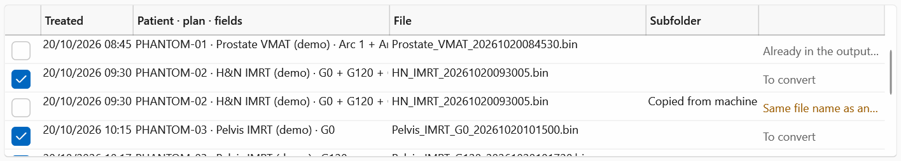

# Trajectory Log Converter

{ .shot }

## What it writes (fixed)

The converter writes **the v4.0 log only**, always the same way:

| | |
|---|---|
| Machine specifier | **TrueBeam (0)** |
| Serial number | **Removed** |
| Couch rotation, pitch and roll | **Kept** |
| Patient, plan, field names, metadata | As in the log |
| File name | The log's own, in the output folder |
| Other files | None: no time-axis file, CSV or run log |

To export with other options, use **Export** in Trajectory Log Tools ([Export options](export-options.md)).
Note that the two differ in one default: Export removes the couch axes, the converter keeps them.

## From

| Option | |
|---|---|
| **Logs in a folder** | The `.bin` logs of the input folder (the default from Settings, or one chosen with **Browse…** for this session; **Back to the default folder** returns). |
| **Include subfolders** | Also the folders inside it. |
| **Only logs treated in this period** | From a date and time to a date and time (the end minute included). |
| **Only at times of day between** | On every day (within the period, if ticked). |
| **One file** | One log, chosen with **Choose file…**. |

The treatment date and time come from the `_yyyyMMddHHmmss` time stamp in the file name, or the file's
modified time.

## To

| Option | Default | |
|---|---|---|
| Output folder | From Settings | **Browse…** chooses another for this session. |
| **Replace logs already in the output folder** | Off | Without it, logs already converted are left out. |

## The list

| Column | |
|---|---|
| (tick) | Convert this log. Logs that won't be converted can't be ticked. |
| **Treated** | Date and time. |
| **Patient · plan · fields** | From the log's header. |
| **File** | The file name. |
| **Subfolder** | Relative to the input folder. |
| (status) | *To convert*, *Converted*, *Skipped: …*, *Failed: …*, or why it won't be converted. |

The line above the list counts them, for example *5 logs to convert · 1 already converted · 1 already v4.0*.
**All** and **None** tick or untick every log; **⟳** looks in the folder again.

## Why a log isn't converted

Tick **Show the logs that won't be converted** to see them.

{ .shot }

| Reason | Means |
|---|---|
| **Already v4.0** | It isn't a v5.1 log. |
| **Already in the output folder** | A file of that name is in the output folder (tick **Replace…** to convert it again). |
| **Same file name as another log in the list** | Two logs (from different subfolders) have the same name; only the first is converted, as both would go to the same file. |
| **Can't be read: …** | The file isn't a readable trajectory log. |
| **The output folder is this log's own folder** | The v4.0 file would replace the original. |

## Settings

The default input folder, **Include subfolders**, and the default output folder, saved in
`TrajectoryLogConverter.settings.json` beside the app. See [Set the converter's folders](../how-to/converter-folders.md).
