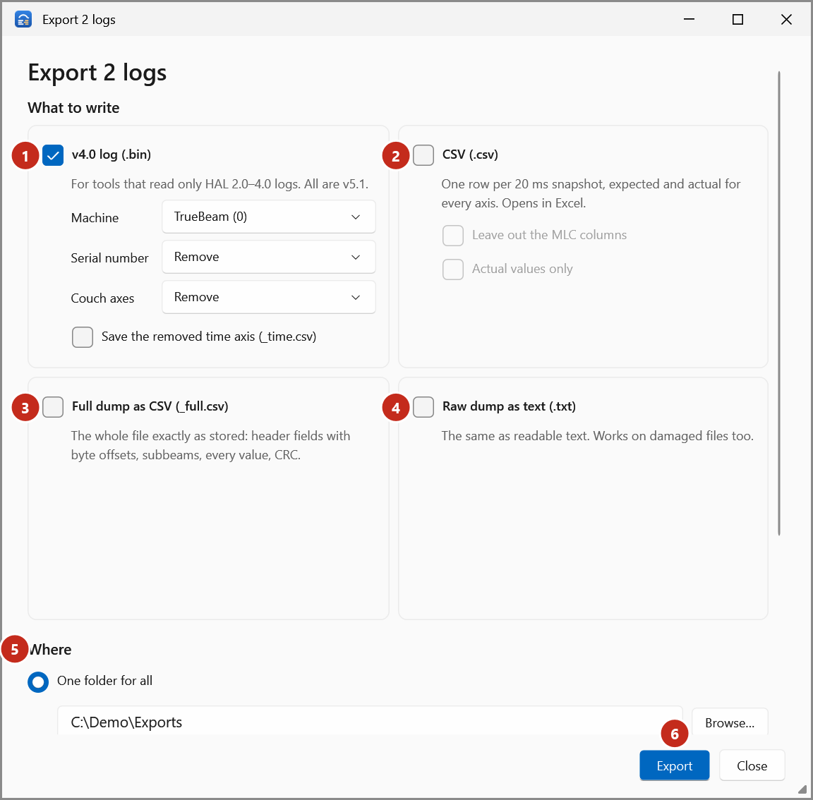

# Export options

Every option of the **Export** window of Trajectory Log Tools. See [Export logs](../how-to/export.md)
for the steps.

{ .shot }

## What to write

| Option | Default | Writes |
|---|---|---|
| **v4.0 log (.bin)** | On | `<log>.bin`, the log as version 4.0. Only for v5.1 logs; others are skipped (*already v4.0*). |
| **CSV (.csv)** | Off | `<log>.csv`: one row per 20 ms snapshot, expected and actual for every axis, in the log's units (cm, degrees, MU). Axes with no value in any snapshot (Halcyon's jaws) are left out. |
| **Full dump as CSV (_full.csv)** | Off | `<log>_full.csv`: the whole file exactly as stored: header fields with byte offsets, subbeams, every value (9 significant digits) and the CRC. |
| **Raw dump as text (.txt)** | Off | `<log>.txt`: the same as readable text, as in the **Raw** tab. Works on damaged files too. |

### v4.0 options (for every log exported)

| Option | Choices | Default |
|---|---|---|
| **Machine** | **TrueBeam (0)**, **Halcyon (1)**: the machine specifier written to the header | TrueBeam (0) |
| **Serial number** | **Remove**, **Keep**, **Change to…** (up to 6 plain characters) | Remove |
| **Couch axes** | **Remove**, **Keep**: couch rotation, pitch and roll | Remove |
| **Save the removed time axis (_time.csv)** | Off / on: v4.0 has no time axis; this keeps it in `<log>_time.csv` | Off |
| **Header details…** | One v5.1 log only: change the patient ID, plan name, plan UID and field names. See [Change header details](../how-to/export-header-details.md). | As in the log |

### CSV options

| Option | Default |
|---|---|
| **Leave out the MLC columns** | Off |
| **Actual values only** | Off |

## Where

| Option | Default | Effect |
|---|---|---|
| **One folder for all** | On | Every file goes into the folder you type or **Browse…** for. Refused if it's the folder of one of the logs, for a v4.0 export. |
| **Next to each log, in a "converted" subfolder** | Off | Each log's files go into `converted\` beside it. |
| **Overwrite existing files** | Off | Without it, a file that already exists is skipped. |
| **Also save a run log (.log) with the files** | Off | `TrajectoryLogConversion_<yyyyMMdd_HHmmss>.log` in each output folder: the logs exported there and what was written. |
| **Also process logs whose CRC does not verify** | Off | Shown only when a log's CRC failed. |

## Results

Each log gets **Done**, **Skipped** (nothing to do, for example a v4.0 log asked for v4.0) or
**Failed**, with the files written or the reason. The line at the bottom totals them.

The same exports are what Trajectory Log Converter writes with fixed options; see
[Trajectory Log Converter](converter.md).
