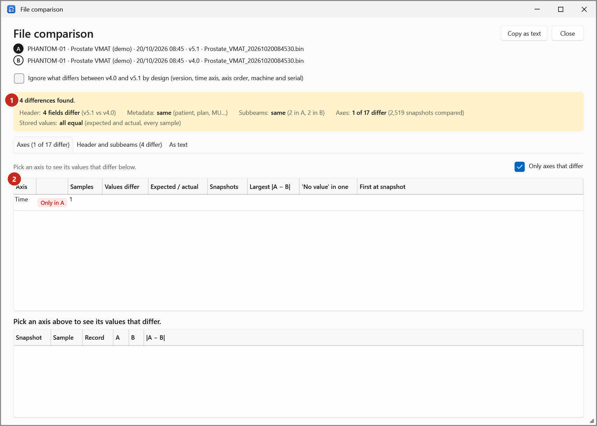
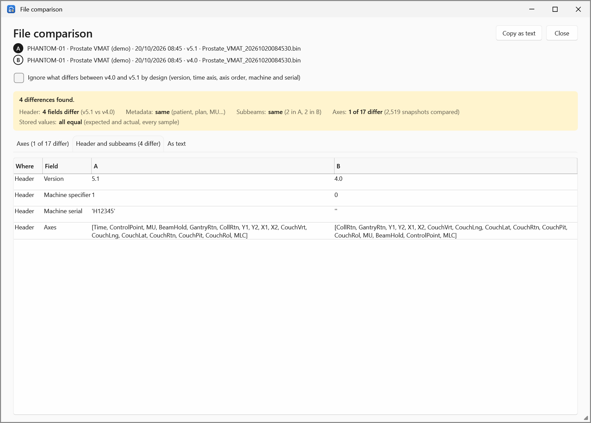

# File comparison

The **File comparison** window compares two `.bin` logs value by value: every header field, metadata
line, subbeam and stored value (expected and actual) of every axis. Open it from the Compare page:
**File differences (validation)** > **Compare the files…**. See
[Validate a v4.0 conversion](../how-to/validate-conversion.md).

{ .shot }

## The top

- **A** and **B**: patient ID, plan, date, version and file name of each.
- **Ignore what differs between v4.0 and v5.1 by design (version, time axis, axis order, machine and
  serial)**: ticked when opened from the Compare page with the same box ticked (the default).
- **Copy as text**: the comparison as text, to paste elsewhere.

## The verdict

| Verdict | Meaning |
|---|---|
| *The files are identical, byte for byte.* | |
| *Same content: every header field, subbeam and stored value is equal* | With the box ticked: *…apart from what differs between v4.0 and v5.1 by design.* |
| *_n_ differences found.* | With *A and B are different patients* or *different plans* when they are. |

## The counts

| Count | Says |
|---|---|
| **Header** | Header fields that differ, and the versions of A and B. |
| **Metadata** | Metadata lines (patient, plan, MU…) that differ. |
| **Subbeams** | Subbeam fields that differ, and the number of subbeams in A and B. |
| **Axes** | Axes that differ, of how many, and the snapshots compared. |
| **Stored values** | Values that differ, the largest \|A − B\|, and values that are "no value" in one log only. |

Notes under the counts say what was ignored or couldn't be compared (for example a CRC that doesn't verify).

## Axes tab

One row per axis (only those that differ, unless you untick **Only axes that differ**):

| Column | Meaning |
|---|---|
| **Axis** | The axis. |
| (status) | **Same**, **Differs**, or why it can't be compared (for example *Missing in B*). |
| **Samples** | Values per snapshot (1, or 116 for the MLC). |
| **Values differ** | How many stored values differ. |
| **Expected / actual** | How many of them are expected values / actual values. |
| **Snapshots** | In how many snapshots. |
| **Largest \|A − B\|** | The largest difference. |
| **'No value' in one** | Values that hold the "no value" marker in one log only. |
| **First at snapshot** | The first snapshot that differs. |

Select an axis to list, below, its values that differ (up to 50): **Snapshot**, **Sample**, **Record**
(expected or actual), **A**, **B** and **\|A − B\|**. Drag the bar between the tables to share the room.

## Header and subbeams tab

{ .shot }

Each field that differs, where it is (**Header**, **Metadata** or a subbeam), and its value in A and B.

## As text tab

The comparison as plain text, as **Copy as text** copies it.
