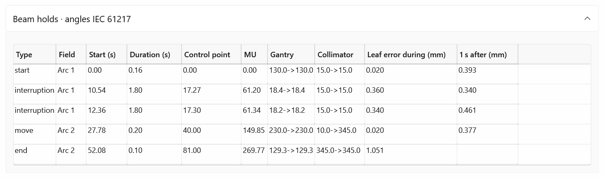
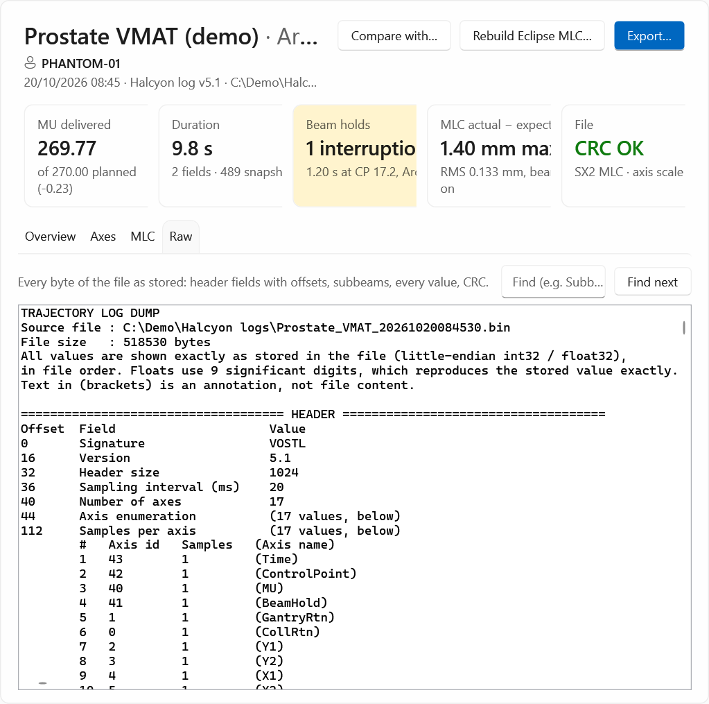

# The log page

What Trajectory Log Tools shows for one log. Select a log in **Open logs** to show its page.

{ .shot }

## The top

- The plan name and its fields (from the log's header), the **patient ID**, and a line with the
  treatment date and time, the log type (for example *Halcyon log v5.1*) and the file's path.
- **Compare with…**: pick another log to [compare with](../how-to/compare-deliveries.md).
- **Rebuild Eclipse MLC…**: [rebuild](../how-to/rebuild-mlc.md) this log (or all the ticked logs, if it is ticked).
- **Export…**: [export](../how-to/export.md) this log.
- A red banner when the log can't be read or analysed; an orange one when its CRC doesn't verify.

## Key facts (1)

| Card | Shows |
|---|---|
| **MU delivered** | The MU delivered, and *of _x_ planned* with the difference. |
| **Duration** | The log's length in seconds, the number of fields and of snapshots. |
| **Beam holds** | The number of interruptions and when the first happened (control point and field), coloured orange; or *No interruptions* with the number of planned holds. |
| **MLC actual − expected** | The largest leaf difference (mm) with the beam on, and the RMS. |
| **File** | *CRC OK* (green) with the MLC and the axis scale, *CRC failed* (red), or *CSV export*. |

## Overview tab

**Delivery timeline (2).** The log from start to end. Blue is beam on (shades alternate by field),
orange is an interruption (the beam held and nothing moved), grey is a planned hold: the start, the
end, or a gantry or collimator move between fields. Hover for the type and the times. The ticks
below are seconds from the start.

**Fields (3).** One row per field (subbeam), with angles in the scale of the **Angles** setting:

| Column | Meaning |
|---|---|
| **Field** | The field's name in the log, or *Field n*. |
| **Gantry** | The planned gantry at the field's first and last beam-on snapshot (one value for a static field). |
| **Collimator** | The planned collimator. |
| **Control points** | The log's control points of the field, from its own first control point. |
| **MU planned**, **MU delivered** | For the field. |
| **Beam on** | Time with the beam on (s). |
| **MLC RMS**, **MLC max** | Actual − expected leaf position with the beam on (mm). |

**Beam holds.** Every hold: its **Type** (*interruption*, *start*, *end*, *move*), field, start and
duration (s), control point, MU, gantry, collimator, the leaf error during the hold and one second
after it (mm).

{ .shot }

**Header and metadata.** The header as stored: sampling interval, snapshots, axes, axis scale,
machine, MLC model, CRC, each subbeam and every metadata line.

## Axes tab

{ .shot }

- (1) The axes recorded in the log. Select one to plot it.
- The top chart: expected and actual. The bottom chart: actual − expected. Zooming or panning one
  moves both.
- (2) **Plot against control point (instead of time)**.

Gantry and collimator follow the **Angles** setting; other axes are shown as recorded.

## MLC tab

{ .shot }

Actual − expected for every leaf (rows) against time or control point, beam on only. The chart on the
right is each leaf's RMS. The line below names the three leaves with the largest RMS.

## Raw tab

{ .shot }

Every byte of the file as stored: header fields with byte offsets, subbeams, every value and the CRC,
with warnings at the top for anything unexpected. Type in **Find** and press ++enter++ or select
**Find next**. Very large logs are shown up to 4 million characters; **Export > Raw dump** writes the
whole file.

## Charts

On every chart: hold ++ctrl++ and turn the wheel to zoom, drag to pan, double-click to go back to the
full view. Right-click for **Open in New Window**, where the wheel alone zooms. See
[Keyboard and mouse](keyboard-mouse.md).
