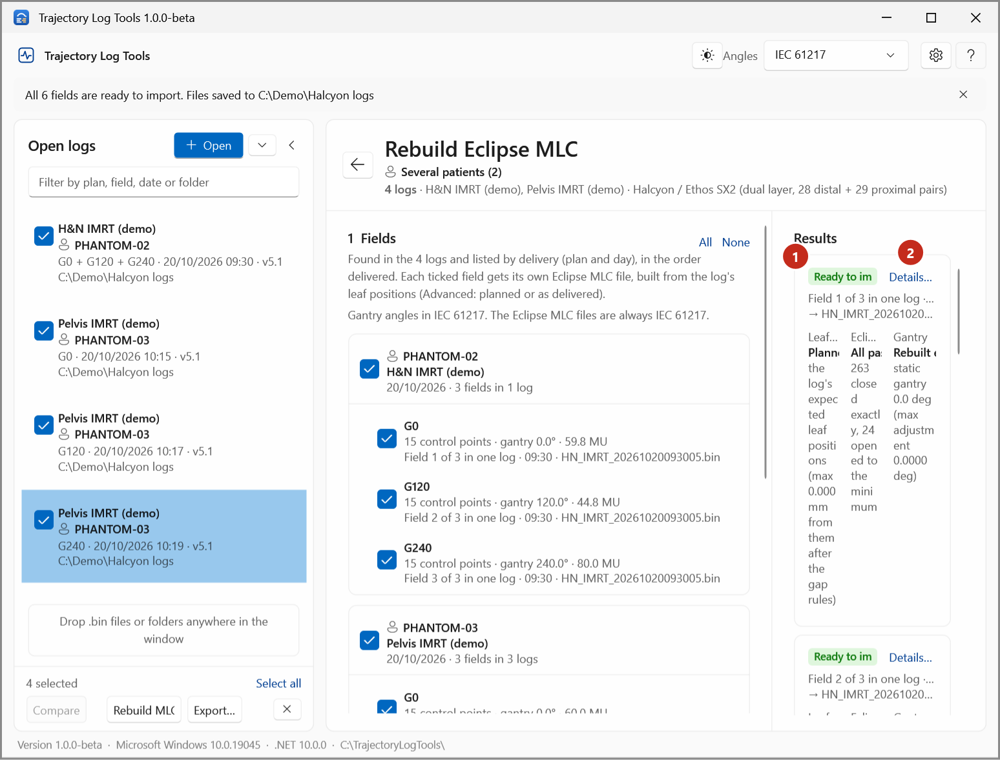
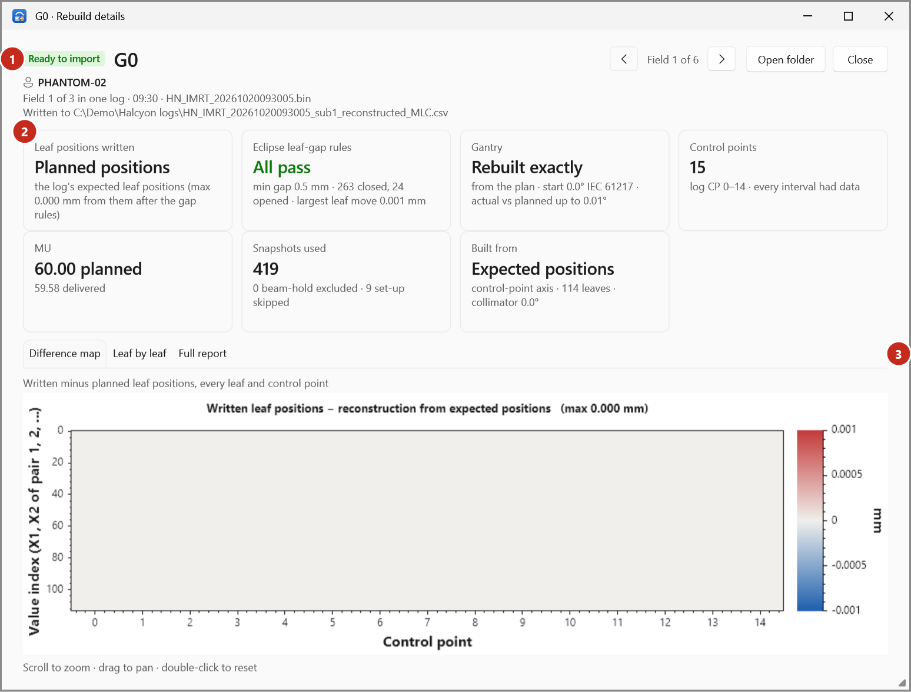

# Rebuild statuses and checks

Each field rebuilt on the **Rebuild Eclipse MLC** page gets one of three statuses:

| Status | Meaning | File written |
|---|---|---|
| **Ready to import** | Every check below passed. | Yes |
| **Check first** | At least one check found a problem. The card and **Details…** list each one. | Yes |
| **Failed** | The field couldn't be rebuilt; the reason is on the card. | No |

!!! warning "To be confirmed"
    What the department does with a *Check first* field before importing it into Eclipse.

## The checks

A field is **Check first** when any of these is true. The sentence on the card says which.

| Check | Message on the card | What it means |
|---|---|---|
| Leaf gaps | *_n_ leaf gap(s) remain that Eclipse may reject (see the report).* | After the gap rules (below), some opposing leaves are still closer than the minimum gap without being closed, or a closed pair moves. |
| Data between control points | *No beam-on samples between control points …; leaf positions there were interpolated.* | Part of the field had no beam-on snapshot to fit, so its leaf positions are interpolated. |
| Gantry | *The gantry is not an evenly spaced arc, so its angles were rounded to 0.01 deg instead of rebuilt exactly.* | Without an Eclipse export, the gantry of an arc is rebuilt exactly only when it is evenly spaced. |
| Eclipse export fits | *The Eclipse export does not look like this beam (gantry differs by up to … deg, meterset weight by up to …).* | With an export: its gantry differs from the log's by more than 0.5° or its meterset weights by more than 0.002. |
| Collimator | *The collimator in the log (…) differs from the Eclipse export (…).* | By more than 0.5°. |
| Method check | *Method check: rebuilding the planned positions differs from the Eclipse export by up to … mm (expected about 0).* | Rebuilding the log's planned positions doesn't reproduce the export's leaves. |

## The result card

{ .shot }

| Column | Shows |
|---|---|
| **Leaf positions written** | *Planned positions* (the default) with how far the written file is from them after the gap rules; or, with **Actual (as delivered)**, the RMS and max difference from the plan and where. |
| **Eclipse leaf-gap rules** | *All pass*, or the number of problems; how many gaps were closed exactly and how many opened to the minimum. |
| **Gantry** | *Rebuilt exactly*, *Rounded to 0.01°* or *From the export*, with how. |

## The details window

{ .shot }

**Details…** shows the field's status (1), what to check, and the QA report's numbers as cards (2):

| Card | Shows |
|---|---|
| **Leaf positions written** | As on the result card. |
| **Eclipse leaf-gap rules** | Minimum gap, gaps closed and opened, the largest leaf move the rules made. |
| **Gantry** | Where it came from (plan, actual, export), the start angle, actual vs planned. |
| **Control points** | The field's control points, the log's control points they came from, and whether every interval had data. |
| **MU** | Planned and delivered. |
| **Snapshots used** | Beam-on snapshots used; beam-hold and set-up snapshots left out. |
| **Built from** | Expected or actual positions, the axis, leaves and collimator. |
| **Eclipse export** | With an export: *Matches the log* or *Doesn't match*, with the method check, gantry and meterset-weight differences. |

The tabs (3): **Difference map** (written minus planned, every leaf and control point), **Leaf by leaf**
(pick a leaf with the slider) and **Full report**. In this window the wheel zooms the charts.
**‹** and **›** step through the fields of the rebuild.

## The gap rules

Eclipse rejects a leaf pair whose gap is neither exactly closed nor at least the minimum dynamic leaf
gap (0.5 mm for the Halcyon / Ethos SX2 MLC). The fitted positions scatter around the planned ones, so
every pair below the minimum is either closed exactly at its centre (gap under half the minimum) or
opened symmetrically to the minimum. A closed pair is kept still, inside the aperture before and after it.
See [How the MLC rebuild works](../explanation/mlc-rebuild.md).

## Not included

Logs that can't be rebuilt at all are listed under **Not included** with the reason, for example an MLC
the app doesn't know (only the Halcyon / Ethos SX2 MLC is supported), no field with the beam on, or a
file that can't be read.
