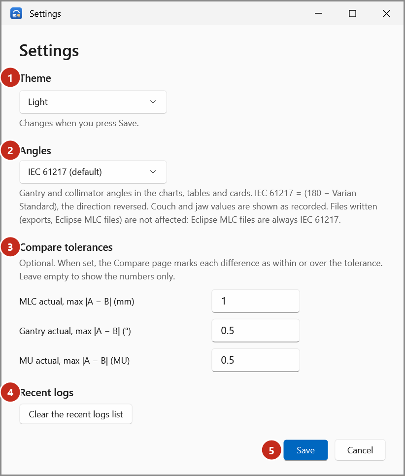

# Settings

Select **Settings** (the gear at the top right of Trajectory Log Tools).

{ .shot }

| Setting | Choices | Default | Effect |
|---|---|---|---|
| **Theme** (1) | **System**, **Light**, **Dark** | Light | The app's colours, and the charts'. Changes when you press **Save**. **◐** at the top of the window switches between light and dark too. |
| **Angles** (2) | **IEC 61217 (default)**, **Varian Standard** | IEC 61217 | How gantry and collimator angles are shown. Also the **Angles** box at the top of the window. Files written aren't affected. See [IEC 61217 and Varian Standard](../explanation/angles.md). |
| **Compare tolerances** (3): **MLC actual, max \|A − B\| (mm)**, **Gantry actual, max \|A − B\| (°)**, **MU actual, max \|A − B\| (MU)** | A number greater than 0, or empty | Empty (none) | When set, the Compare cards say *Within* or *Over*. See [Set Compare tolerances](../how-to/set-tolerances.md). |
| **Recent logs** (4): **Clear the recent logs list** | | | Empties **Recent logs** (in the **▾** menu and on the start page). Takes effect straight away. |

Select **Save** (5) to keep the changes, or **Cancel**.

## Where settings are kept

Per Windows user, in `%AppData%\TrajectoryLogTools\settings.json`, with the last 12 files opened.
No folder is remembered: logs can be anywhere, and the file dialogs open where Windows last browsed
(or in the launcher's start folder).

Trajectory Log Converter has its own settings, the default folders, kept in the app's folder:
see [Set the converter's folders](../how-to/converter-folders.md).

!!! note "Defaults that never change silently"
    Run logs (Export) and QA report files (Rebuild) are written only when you tick their box, each
    time. They're not settings.
