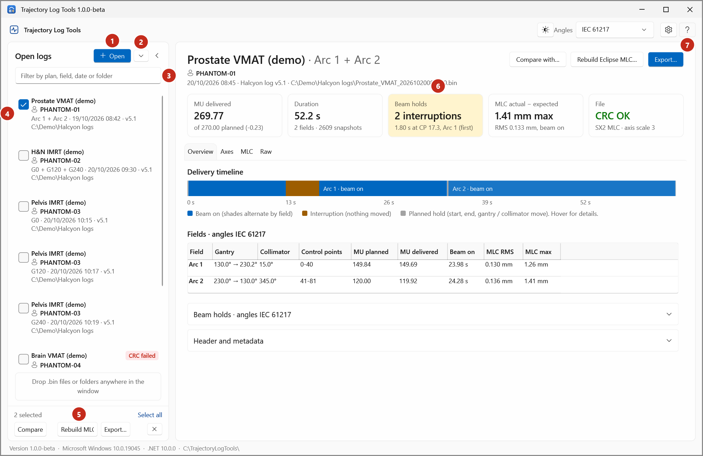
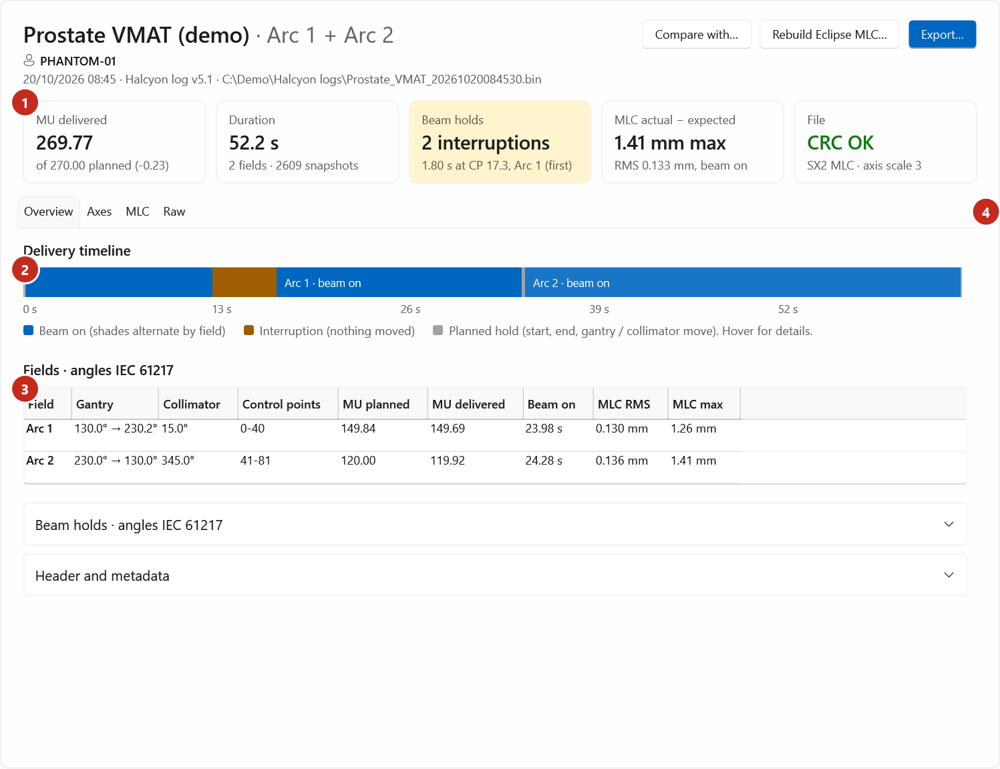
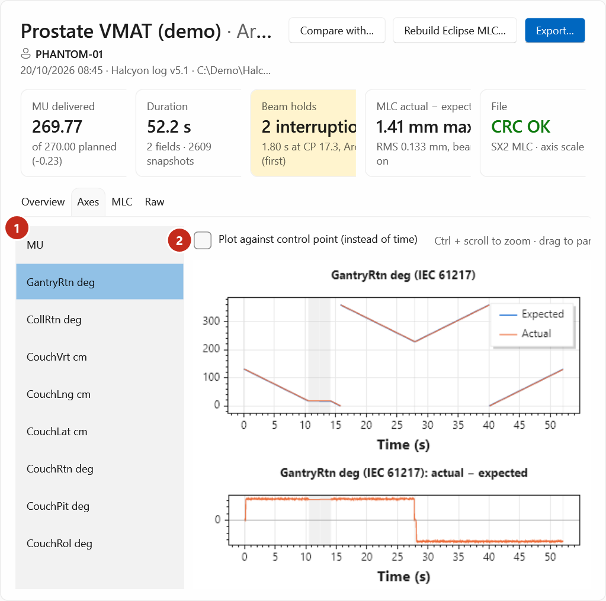
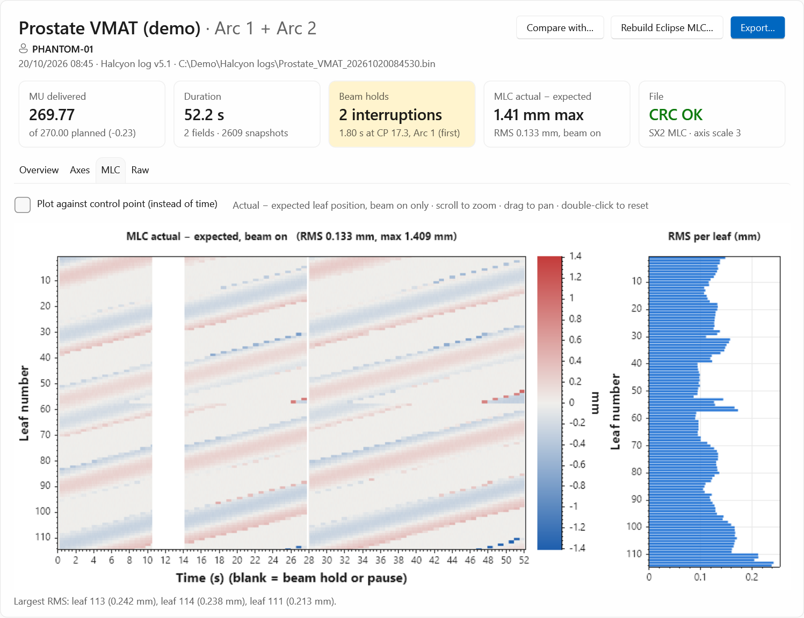

# Your first look at a log

In this tutorial you open a trajectory log and find out what happened during the delivery: how much
was delivered, whether the beam was interrupted, and how well the MLC followed the plan.

You need: Trajectory Log Tools, and a `.bin` trajectory log you're allowed to open.

## 1. Open the log

1. Start Trajectory Log Tools.
2. Select **Open files…**, find the log and select **Open**. You can also drag the file onto the window.

The log appears in **Open logs** on the left, and its page on the right.

{ .shot }

| | |
|---|---|
| (1) **Open** | Opens more logs. |
| (2) **▾** | **Add from folder…** and **Recent logs**. |
| (3) Filter | Shows only the logs whose plan, patient ID, field, date or folder match what you type. |
| (4) Ticks | Select logs for **Compare**, **Rebuild MLC…** and **Export…** (5). |
| (6) Key facts | The delivery at a glance. |
| (7) **Help** | This guide, at the page for what you see. |

## 2. Read the key facts

Across the top of the page are cards:

{ .shot }

- **MU delivered**, against the plan's MU.
- **Duration** of the log, the number of fields and of snapshots (one every 20 ms).
- **Beam holds**: the number of **interruptions** (unplanned holds), or *No interruptions*. An
  interruption colours the card.
- **MLC actual − expected**: the largest leaf difference with the beam on, and its RMS.
- **File**: whether the file's CRC checksum verifies, and its MLC.

In the example, the delivery had one interruption of 1.8 s in Arc 1.

## 3. Follow the delivery timeline

The **Delivery timeline** (2) shows the whole log from left to right:

- blue: beam on (the shade changes with each field);
- orange: an interruption, when nothing moved;
- grey: planned holds, such as the start, the end, and gantry or collimator moves between fields.

Hover over a stretch to see what it is and when it started and ended.

Below it, **Fields** (3) has a row per field: gantry and collimator (in IEC 61217 unless you
changed the **Angles** setting), control points, MU planned and delivered, beam-on time and the MLC
error. Open **Beam holds** for every hold, with the leaf error during and one second after it.

## 4. Look at an axis

1. Select the **Axes** tab (4).
2. In the list, select **Gantry** (it's selected first).

{ .shot }

The top chart shows expected and actual against time; the bottom one shows actual − expected.
To zoom, hold ++ctrl++ and turn the mouse wheel over a chart; drag to pan; double-click to go back to
the full view. Tick **Plot against control point (instead of time)** (2) to line the deliveries up by
control point instead.

## 5. Look at the MLC

Select the **MLC** tab.

{ .shot }

Each row is a leaf; colour shows actual − expected with the beam on. The narrow chart on the right
is each leaf's RMS, and the line below names the leaves with the largest RMS.

## 6. See the raw file (optional)

The **Raw** tab shows every byte of the file: the header with byte offsets, the subbeams (fields),
every value and the CRC. Type in **Find** (for example `Subbeam` or `CRC`) and select **Find next**.

## What you've learnt

You opened a log, read its key facts, found the interruption on the timeline, and looked at an axis
and the MLC. Next: [Your first delivery comparison](first-comparison.md).

For every card, tab and column, see [The log page](../reference/log-page.md).
